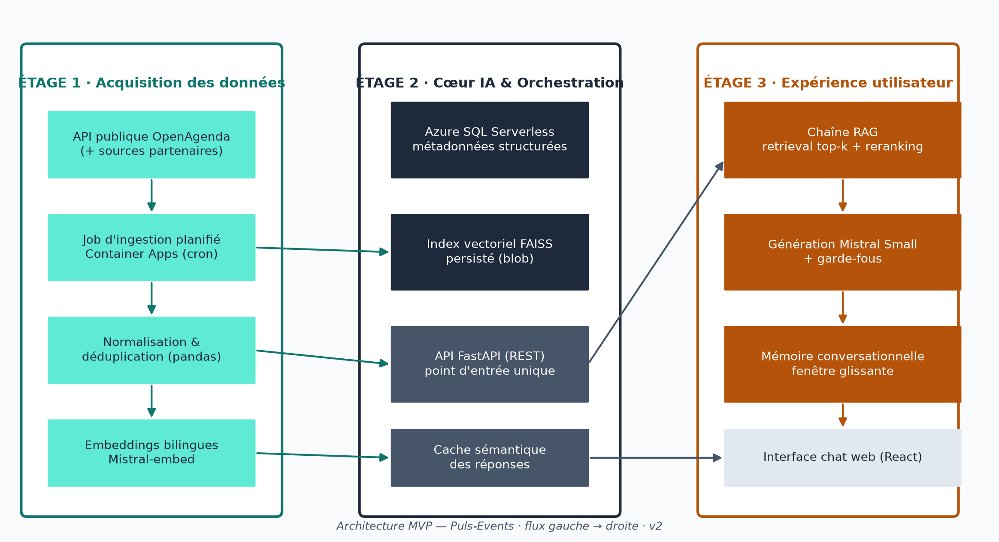

# Puls-Events — Cadrage & Conception d'Architecture MVP (Chatbot RAG)

Ce dépôt rassemble l'étude de gestion de projet et l'ingénierie d'architecture pour le passage à l'échelle d'un assistant conversationnel culturel intelligent (RAG), dans le cadre du projet OpenClassrooms « Passez votre système IA du POC au MVP ».

---

## Vue d'Ensemble & Architecture Cible

Le projet structure la trajectoire industrielle permettant de transformer un démonstrateur local (POC validé lors du Projet 11) en un Minimum Viable Product (MVP) conteneurisé, résilient et scalable sur le Cloud Microsoft Azure.

L'architecture s'organise en trois étages découplés :
1. **Étage 1 · Acquisition & Préparation des données** : Ingestion planifiée (Container Apps cron) des flux OpenAgenda, normalisation Pydantic, déduplication et calcul d'embeddings vectoriels bilingues Mistral-embed.
2. **Étage 2 · Cœur IA & Orchestration** : API unifiée FastAPI, base SQL Serverless pour les métadonnées événementielles, index vectoriel FAISS versionné sur Blob Storage et cache sémantique des requêtes fréquentes.
3. **Étage 3 · Expérience Utilisateur** : Interface conversationnelle React avec mémoire multi-tours à fenêtre glissante, reranking contextuel et garde-fous stricts contre les hallucinations.

---

## Livrables Officiels (OpenClassrooms)

L'ensemble des livrables de certification est accessible directement sous format normalisé :

- **Livrable 1** : [`Chaussoy_Jean-Francois_1_rapport gestion projet_042026.pdf`](./Chaussoy_Jean-Francois_1_rapport%20gestion%20projet_042026.pdf)  
  *Rapport complet de cadrage, analyse des besoins, choix d'architecture et étude FinOps (19 pages, format officiel PDF).*
- **Livrable 2** : [`Chaussoy_Jean-Francois_2_support presentation_042026.pdf`](./Chaussoy_Jean-Francois_2_support%20presentation_042026.pdf)  
  *Support de soutenance officiel en 12 diapositives au format 16:9.*
- **Livrable 3** : [`Chaussoy_Jean-Francois_3_portfolio et code_042026.pdf`](./Chaussoy_Jean-Francois_3_portfolio%20et%20code_042026.pdf) ([version texte](./Chaussoy_Jean-Francois_3_portfolio%20et%20code_042026.txt))  
  *Fiche officielle des liens vers le Portfolio Web et les dépôts GitHub associés.*
- **Archive de soumission officielle** : [`Livraison/Passez_votre_systeme_IA_du_POC_au_MVP_Chaussoy_Jean-Francois.zip`](./Livraison/Passez_votre_systeme_IA_du_POC_au_MVP_Chaussoy_Jean-Francois.zip)  
  *Archive ZIP consolidée prête pour le téléversement sur la plateforme d'évaluation.*

---

## Schémas et Diagrammes d'Architecture

L'ensemble des schémas d'architecture, diagrammes de flux et graphiques FinOps du projet sont centralisés dans le dossier [`img/`](./img/).

---

## Synthèse Métier & Chiffrage du Projet

| Indicateur | Valeur Cible | Justification & Méthodologie |
| :--- | :---: | :--- |
| **Charge Globale (BUILD)** | **31 j/h** | Macro-Backlog MoSCoW (8 lots : 24 j Must, 5 j Should, 2 j Could) |
| **Budget Initial (BUILD)** | **14 260 € HT** | Base Taux Journalier Moyen (TJM) Data Engineer junior : 460 € HT |
| **Coût d'Exploitation (OPEX)** | **~76 € HT / mois** | Modèle serverless optimisé (-33 % d'économie via cache sémantique) |
| **Planning Prévisionnel** | **8 semaines** | Cycle en V (cadrage/recette) couplé à Agile Scrum (sprints de 2 sem.) |
| **Gouvernance & Qualité** | **RGPD & Sécurité** | Chiffrement TLS, Azure Key Vault, isolation des sessions utilisateurs |

---

## Liens & Portfolio Professionnel

- **Site Web du Portfolio** : [https://jfc-webcraft.fr/](https://jfc-webcraft.fr/)
- **Profil GitHub** : [https://github.com/jfcwebcraft](https://github.com/jfcwebcraft)
- **Dépôt GitHub du Projet 13 (MVP)** : [Projet-13-Passez-votre-systeme-IA-du-POC-au-MVP](https://github.com/jfcwebcraft/Projet-13-Passez-votre-systeme-IA-du-POC-au-MVP)
- **Dépôt GitHub du Projet 11 (POC RAG)** : [Projet-11-PulsEvents-RAG-Assistant-Culturel-Intelligent](https://github.com/jfcwebcraft/Projet-11-PulsEvents-RAG-Assistant-Culturel-Intelligent)

> **Note de confidentialité :** Conformément aux clauses de confidentialité en entreprise (projets menés au sein de la Communauté d'Agglomération du Boulonnais : Projets 10 et 12), les dépôts correspondants restent sous accès privé.
